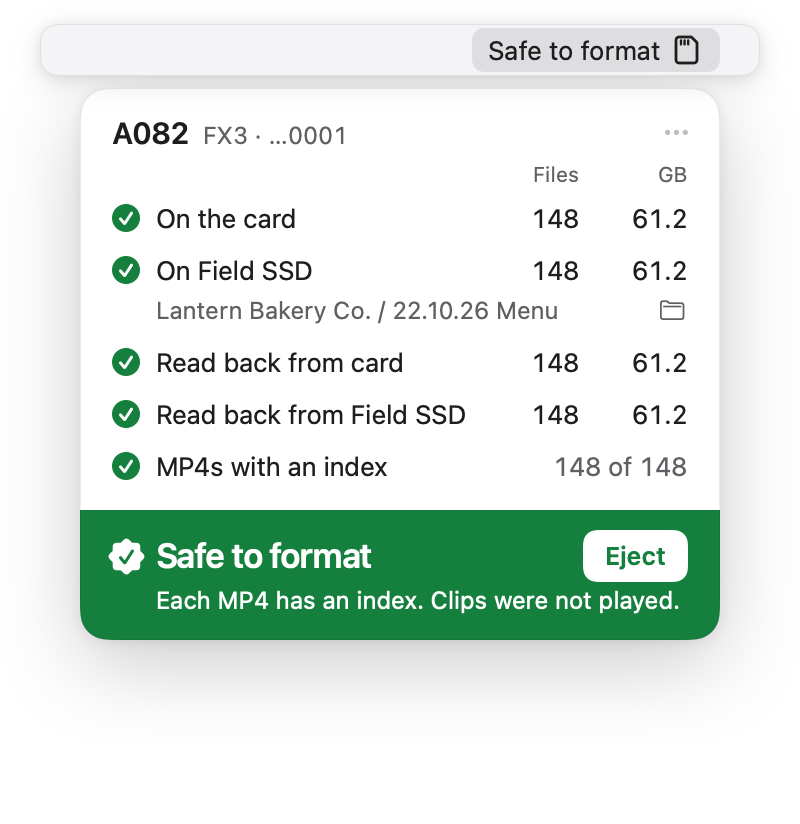
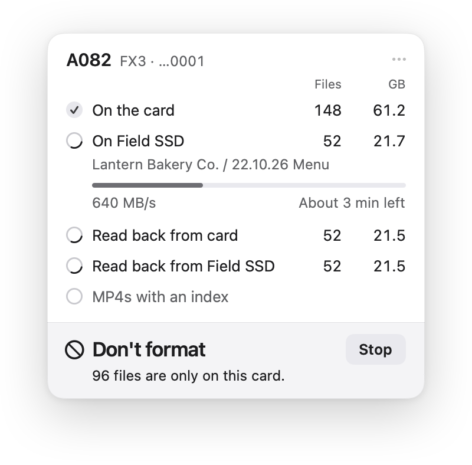
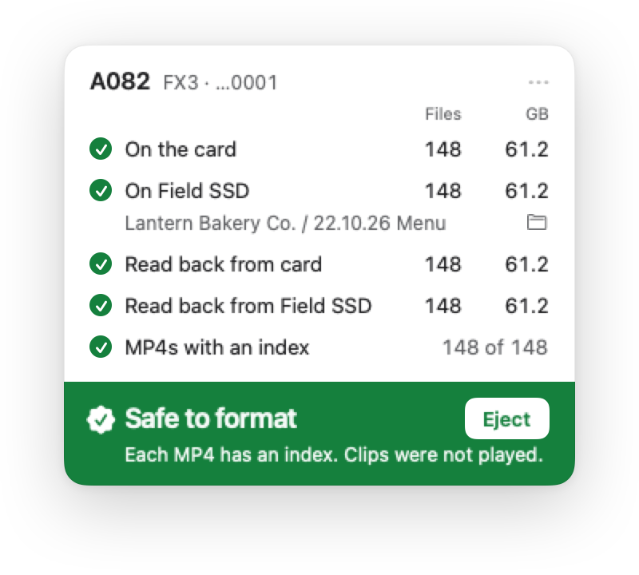
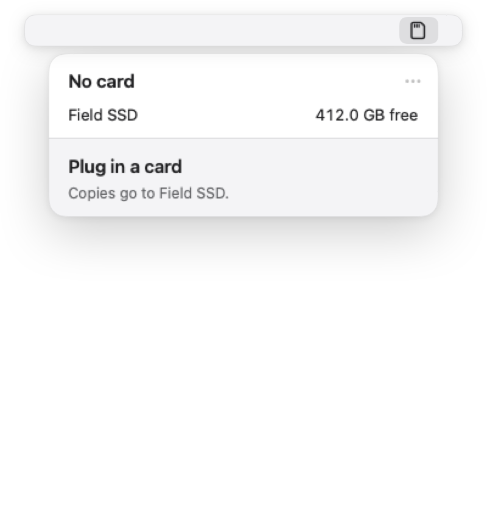

# Ingest

A small Mac app that copies your camera card to your drive, checks every file, and tells you when it's safe to format.

<p align="center">
  
</p>

Ingest lives in your menu bar. Plug in a card and a small widget opens by itself. Name the shoot, press Copy, and go do something else. When it's finished, the widget turns green and says **Safe to format**.

If the card is already on your drive, Ingest notices and checks it, so you don't have to copy it again.

<p align="center">
  
  <picture>
    <source media="(prefers-color-scheme: dark)" srcset="docs/media/widget-safe-dark.png">
    
  </picture>
</p>

Ingest is in beta, so for now please keep a second copy before you format a card.

## Download

Get **Ingest.dmg** from the [latest release](https://github.com/skyfallstatus/ingest/releases/latest). After that, the app updates itself.

You'll need macOS 14 or later. So far it has only been tested on macOS 27 with Apple silicon: macOS 14, 15 and 26 are untested, and it hasn't run on an Intel Mac yet. If you're on one of those, please try it and tell us how it goes.

## Installing

Ingest isn't signed by Apple yet, so macOS asks you to confirm the first time. It takes a minute, and you only do it once per version.

1. Open `Ingest.dmg` and drag Ingest to Applications.
2. Open Ingest. macOS says it can't be opened. Click **Done**.
3. Go to **System Settings › Privacy & Security** and scroll down to **Security**.
4. Next to the message about Ingest, click **Open Anyway**, enter your password, then click **Open**.

On macOS 14 you can skip all that: Control-click the app and choose **Open**.

When macOS asks if Ingest can read removable volumes, say yes. You'll see this question again after each update for now.

The first time you plug in a drive, Ingest reads how your folders are organised and follows the same pattern.

<p align="center">
  
</p>

Can't see the icon? A full menu bar can hide it. Open Ingest from Applications again and the widget appears.

## What "Safe to format" means

Ingest only says it when all of this is true:

- Every file on the card was copied to your drive.
- Every file was read back from the drive and read again from the card, and the two match exactly.
- The card and the drive stayed plugged in the whole time.

If you unplug the card or the drive, Ingest checks everything again when it comes back. That takes about as long as reading the card once.

If something doesn't match, Ingest tries once more and then tells you which file. A file that fails is never given its real name on your drive, so a bad copy can't pass for a good one.

The full rules are in [docs/SAFETY.md](docs/SAFETY.md).

## Good to know

- **It checks the data. It doesn't watch your clips.** A clip that was already broken in camera will copy and match perfectly. For many formats Ingest also checks that clips are complete, but it's still worth opening a few yourself.
- **One copy is one copy.** Safe means your drive holds what the card held. Drives can still fail later, so keep a backup.
- **"Have a look"** means Ingest couldn't be completely sure, and the widget says why. Treat the card as not safe yet.
- **Your cards are never written to.** On your drive, Ingest adds a hidden `.ingest` folder for your setup and its notes, and an `ascmhl` folder beside each card it copies, so other tools can check the copy too.

## Cameras

Any card can be copied and checked, whatever the camera. What varies is whether Ingest recognises the card, names the camera and can check that clips are complete. Some of that has been tested on real cards, and some so far only from the manufacturers' documents.

If you shoot on something marked "Documents only", you'd be a big help: tell us how it goes.

<details>
<summary>What's been tested on what</summary>

- **Real card:** the app has run on a whole card, or a whole card folder, as the camera wrote it.
- **Real files:** real clips from that camera were tested, but loose.
- **Documents only:** built from manuals and specifications, with no real file yet.

| Maker | Camera or format | Tested on | Notes |
|---|---|---|---|
| Sony | FX2 | Real card | Mounted, copied and proved end to end |
| Sony | FX3, FX6 | Real card | Whole card folders from a drive, not mounted cards |
| Sony | ZV-E1, ZV-E10, A7S III | Real files | |
| Sony | F55 RAW on an AXS-R5 | Real files | One public clip |
| Sony | A7 IV, A7C II, A7R V, A1, A1 II, A9 III, FX30 | Documents only | Same family as the FX3 |
| Sony | VENICE, BURANO, X-OCN | Documents only | |
| Canon | EOS R6, R5 Mark II | Real files | Loose clips |
| Canon | Cinema EOS and R5 C: CRM, XF-AVC | Documents only | |
| Blackmagic | URSA Cine, PYXIS, Cinema Camera 6K, Pocket 6K, URSA Mini Pro | Real files | Public clips |
| Blackmagic | Pocket 4K CinemaDNG | Real files | Public clips |
| Blackmagic | Striped BRAW, `.braw` with `.braw2` | Documents only | Waits until both halves are together |
| RED | DSMC, 2015 firmware | Real files | One public clip |
| RED | KOMODO, KOMODO-X, V-RAPTOR | Documents only | |
| ARRI | ALEXA 35, Mini LF, ALEXA LF, ALEXA 65 | Real files | Public samples |
| ARRI | Compact Drive through Codex | Documents only | HDE volumes never go green |
| GoPro | HERO5 to HERO8, MAX | Real files | Public clips |
| DJI | Osmo Pocket 3 | Real files | |
| Insta360 | X3 | Real files | |
| Apple | iPhone | Real files | |
| Sound Devices | MixPre-10 II | Real files | |
| Nikon | NEV, R3D NE | Documents only | Stills tested from public files |
| Panasonic | P2, GH7, EVA1 | Documents only | Stills tested from public files |
| Fujifilm | Movies | Documents only | Stills tested from public files |
| Zoom, Tascam | Recorders | Documents only | |

</details>

Your working drive can be exFAT, APFS or HFS+. FAT32 works too, up to 4 GB a file.

## Updates and privacy

Once a day Ingest asks GitHub if there's a new version. That request is the only thing it sends: there's no account and no tracking. New versions download quietly, and the widget shows a **Restart** button. If you don't press it, the update installs next time the app quits. It never interrupts a copy. You can turn updates off in Settings.

Report a Bug and Suggest a Feature copy your report and open a blank GitHub page. Nothing is sent unless you paste it and press submit. Reports never include file names, paths, client names, serials or drive names.

## Contributing

Bug reports, camera samples and ideas are all welcome. See [CONTRIBUTING.md](CONTRIBUTING.md).

<details>
<summary>Building from source</summary>

You need Swift 6.2 or later. Command Line Tools are enough, so you don't need Xcode. The one dependency is [Sparkle](https://sparkle-project.org), which installs updates, and SwiftPM fetches it.

```sh
swift build              # everything
scripts/test.sh          # the tests. No hardware needed, wants 150 GB free
scripts/build-app.sh     # dist/Ingest.app
scripts/build-dmg.sh     # dist/Ingest.dmg
```

`ingestctl` is a small command line tool over the same engine. `ingestctl match <card> <drive> --confirm` compares a card with a drive without writing to either. It's a quick look, and weaker than the app, because it can't ask the drive to finish writing.

```
Sources/IngestCore   copying, checking, the verdict, camera formats, drive layouts
Sources/CIngest      the C layer: uncached reads and writes, XXH64
Sources/IngestApp    the menu bar app
Sources/ingestctl    the command line tool
docs/research        how the rules were arrived at
```

</details>

## License

MIT. See [LICENSE](LICENSE). Credits are in [NOTICE](NOTICE).
